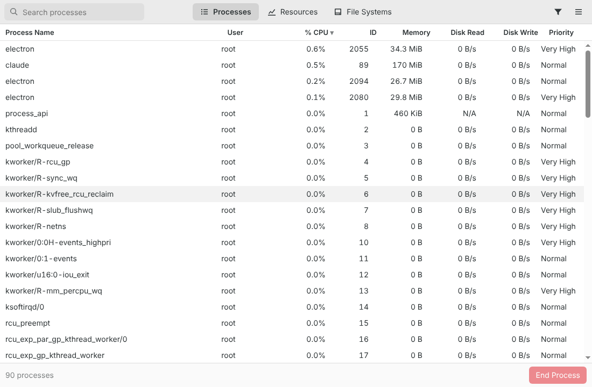
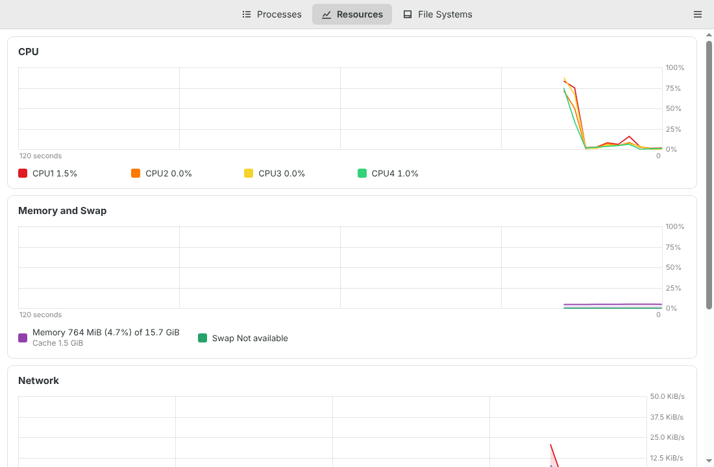
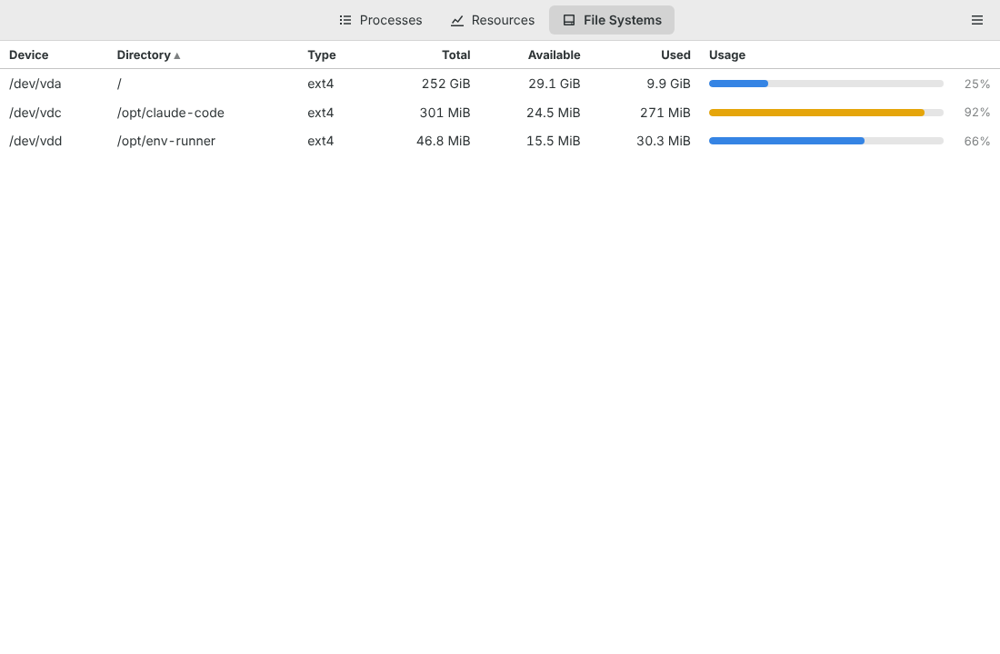
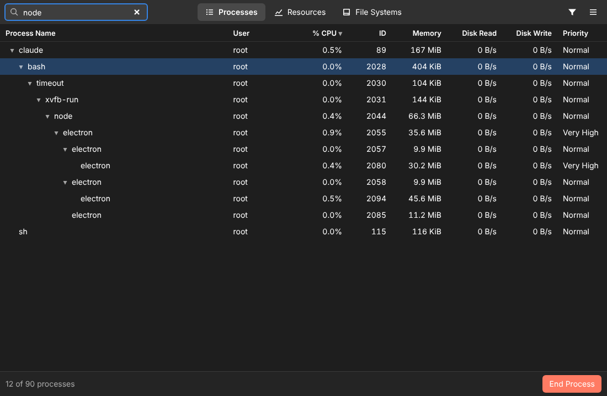

# System Monitor (NodeDesktop)

A Linux system monitor built with Electron and plain JavaScript, modelled on
GNOME System Monitor.



## Features

**Processes**
- A live process list with name, user, % CPU, ID, memory, disk read/write rates
  and priority.
- Search by name, user, command line or exact PID.
- Filters for All, My and Active processes, and a tree view (Show
  Dependencies).
- Stop, Continue, End and Kill, with confirmation for End and Kill.
- Change priority with presets or a custom nice value.
- Properties, Open Files and Memory Maps for each process.
- When an action needs more rights, the app offers to retry through polkit.

**Resources**
- A per-core CPU history graph.
- A memory and swap graph, including cache.
- Network receive/send rates and totals.
- Disk read/write rates and totals.

**File Systems**
- Mounted storage file systems with device, mount point, type, total,
  available, used and a usage bar.

**General**
- Follows the desktop's light or dark theme.
- GNOME keyboard shortcuts (`Ctrl+?` lists them).
- An update interval of 1, 2, 3 or 5 seconds.
- Settings and window size are remembered.

| Resources | File Systems | Tree, dark theme |
| --- | --- | --- |
|  |  |  |

## Getting started

Requires Linux and Node.js 20 or newer.

```bash
npm install
npm start          # run the app
npm test           # unit tests (node:test, no Electron needed)
npm run dist       # build an AppImage and a .deb into dist/
```

## Architecture

See [docs/ARCHITECTURE.md](docs/ARCHITECTURE.md) for the process model, data
sources, sampling strategy, IPC contract, security model and UI architecture.

In short, the main process reads `/proc` directly with async I/O, with no
native modules and no shelling out per tick. A sandboxed preload exposes a
small typed API. The renderer is plain ES modules with a virtualized process
table and canvas charts.

## License

GPL-3.0-or-later
